# Design audit: mustakheem.site and its live projects, and the Hop redesign

*Audited 27 Nov 2026. Each site was loaded in headless Chromium (Playwright) at 1440×900 and 390×844, scrolled screen by screen, and checked for fonts, colours, CSS variables, keyframes and animation libraries. The screenshots in `img/` come from those runs.*

---

## 1. Summary

The portfolio contains eight sites in two families:

- **Product sites**: Cravvingss, SheDrives, Wackowrld, and the portfolio itself. They are light and calm, built around a strong headline, one accent colour and real photography. Every element has a job.
- **Design concepts**: Noir, Asake M$NEY, Shanghai and ami. These are cinematic, dark scroll stories built in chapters. Each one has a single set-piece interaction that it is remembered by.

All eight share a recognisable **house style**:

- One or two font families, almost always **Inter Tight**.
- A **mono font used only for real data and captions**.
- **One accent colour**.
- **Lenis** smooth scrolling.
- An **expo ease-out** curve.
- **Numbered chapters**.
- **Real photos or video**.

Motion is driven by scroll position, and no site has an animation playing everywhere at once.

The old Hop broke most of these rules: four fonts, a multicolour pastel palette, made-up "telemetry" labels, no photos, and many small effects (text scramble, blinking colon, ping, marquee, a refracting glass navbar). The redesign brings Hop in line with the house style and adds one set-piece of its own, **"Scroll to change the time"**, adapted from the Shanghai concept.

---

## 2. Site by site

### 2.1 mustakheem.site (portfolio)
| | |
|---|---|
| **Stack** | Vite + React, CSS keyframes only (no motion library) |
| **Type** | Inter Tight Variable for everything. Hero "Hello" at **216px, weight 250, −0.055em tracking**. Silkscreen (pixel font) only in the marquee |
| **Colour** | `#fff` / ink `#111` / grey `#8a8a8a` / line `#e9e9e9`. Strictly monochrome |
| **Layout** | Floating icon-pill navbar centred at the top, a vertical side rail ("Software Engineer … 2026"), stat counters (`+07 Live projects`, `+4 Hackathon podiums`), a black-and-white cut-out portrait, project cards with real screenshots, experience as right-aligned rows with link pills |
| **Motion** | `rise`, `fade`, `slide`, `pill-in` keyframes on `cubic-bezier(.22,.75,.2,1)`. A pixel-font marquee ("· OLACODES · M…") |
| **Standout** | Confidence through restraint. Very large, very light type and a lot of white space |

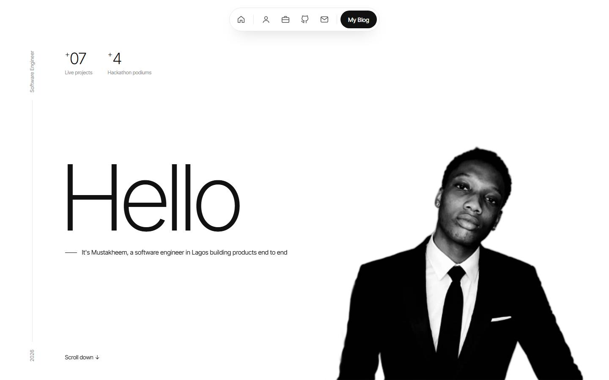
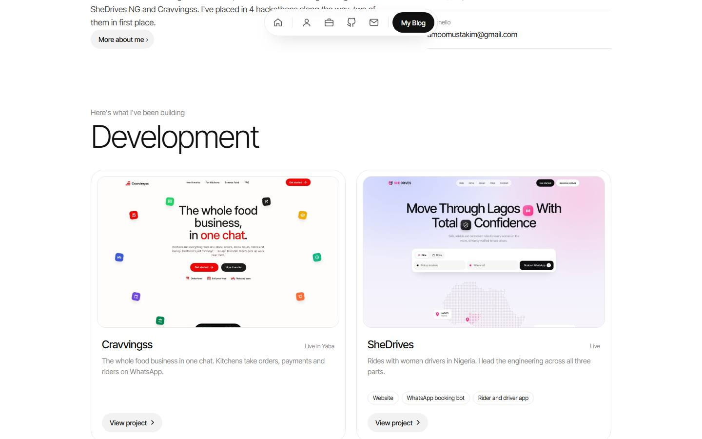
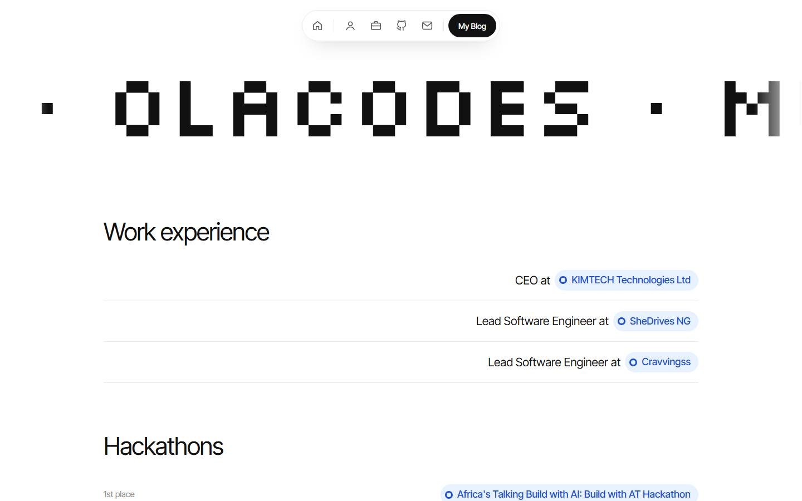

### 2.2 Cravvingss (cravvingss.shop)
| | |
|---|---|
| **Stack** | Next.js (Turbopack), Lenis |
| **Type** | Inter Display 500 (hero at 138px), Manrope, Space Grotesk, Material Symbols icons |
| **Colour** | Cream background, red `#EF0606` for primary actions, orange `#F47735` for secondary actions and full-bleed sections |
| **Layout** | A centred hero headline with **a food photo pill and an arrow glyph inline in the sentence**, a CTA pill set into the last line, full-bleed orange storytelling sections |
| **Motion** | 25 keyframes (`storyIn`, `popIn`, `floaty`, `dash-drift`, `hsPhoneIn`, `lpFocus`…). **Scroll-linked word-by-word colour fill** on the long paragraphs |
| **Standout** | Images placed inside the headline, and text that fills in as you scroll |

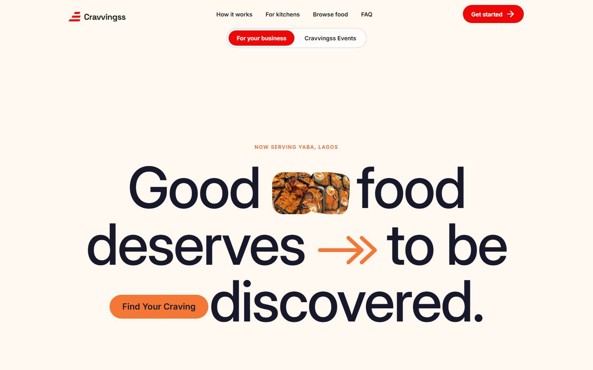
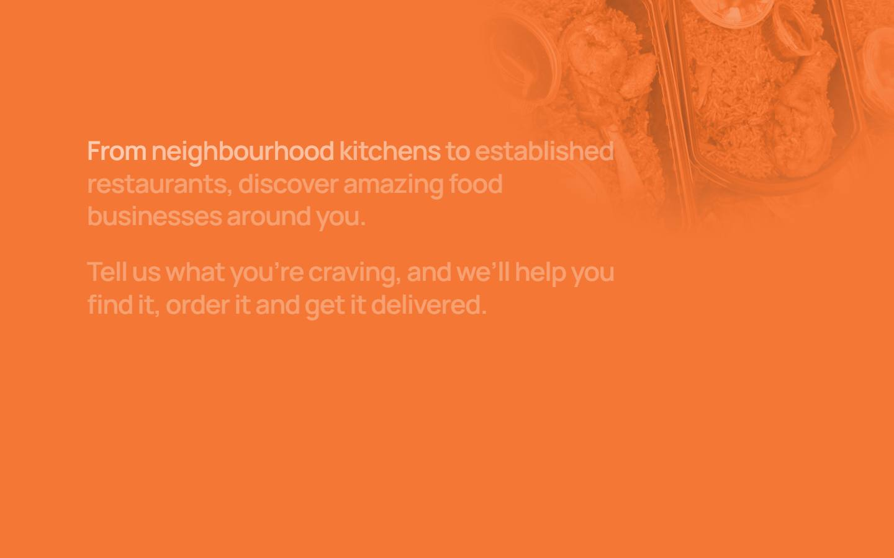

### 2.3 SheDrives (shedrivesng.com)
The closest relative of Hop: a Lagos mobility product.

| | |
|---|---|
| **Stack** | Next.js, Lenis, self-hosted Inter Tight |
| **Type** | **Inter Tight only**. H1 at 78px, weight 500, −0.035em |
| **Colour** | Ink `#0f0f11`, one accent pink `#f5338b` with a soft tint `#fde7f1`, surface `#f6f6f7`. Defined as semantic CSS variables (`--accent`, `--ink`, `--muted`, `--line`) |
| **Layout** | Pill nav plus two CTAs, an icon tile inline in the H1, a booking widget in the hero, a **dot-matrix map of Nigeria** with a Lagos pin, a "How it works" pill eyebrow, a headline whose **second half is greyed out** ("Your ride in *three steps*"), a **sticky phone mockup** next to numbered steps that light up as you scroll, real driver and car photos |
| **Motion** | Very little: a `ping` on the map pin and scroll-progress step highlighting |
| **Standout** | It reads as a real product. Every visual explains the service |

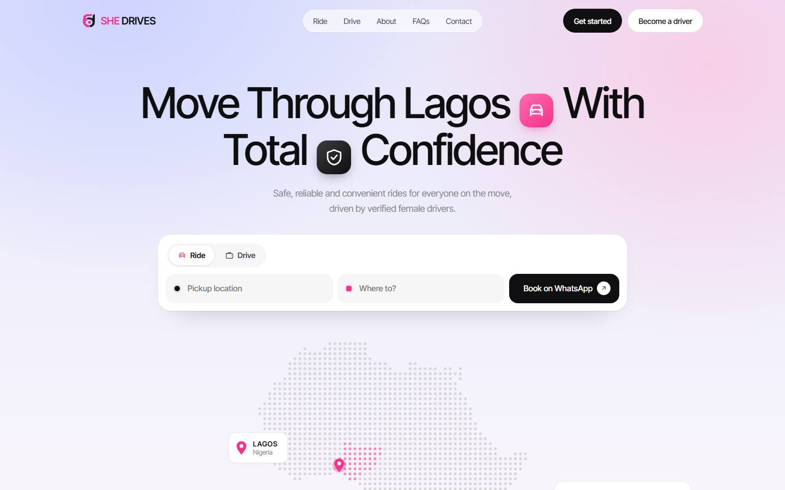
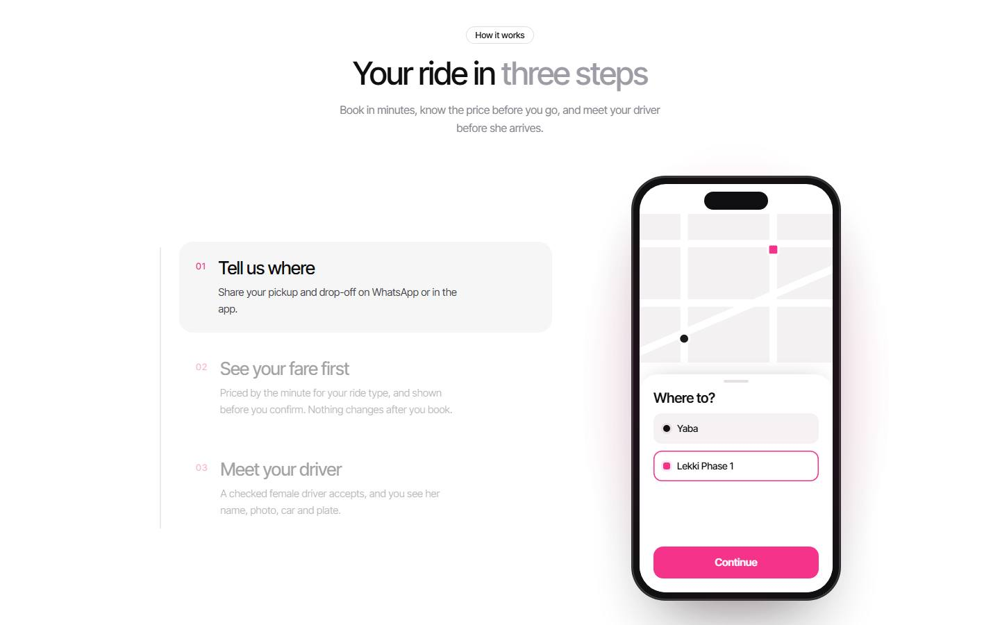
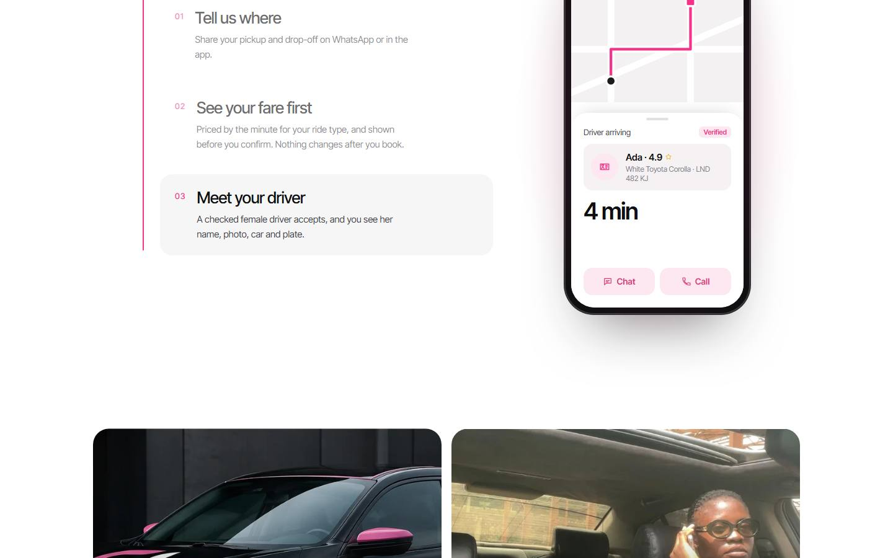

### 2.4 Wackowrld (wackowrld.shop)
| | |
|---|---|
| **Stack** | Next.js storefront, Lenis, custom cursor |
| **Type** | Space Grotesk for body and headings, Anton for display, wide-tracked uppercase for labels |
| **Colour** | Bone `#f4f1ea`, ink `#0c0c0d`, flare red `#ff3b1f`, acid lime `#d8ff47` (rare) |
| **Layout** | Announcement bar, a **full-bleed video hero** with a custom wordmark, an outlined "ENTER THE WRLD ↓" button, a product grid with **red "01 / TEES" numbering** and "COP IT" text links |
| **Motion** | `ww-sweep`, `fit-in`. Most of the energy comes from the video |
| **Standout** | A strong brand voice, and numbered editorial labels used for commerce |

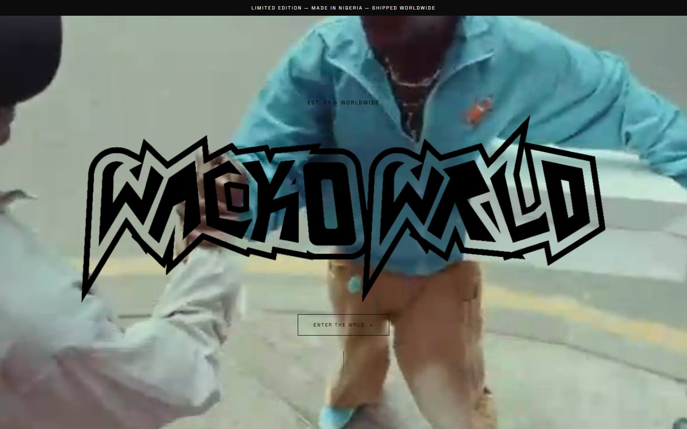
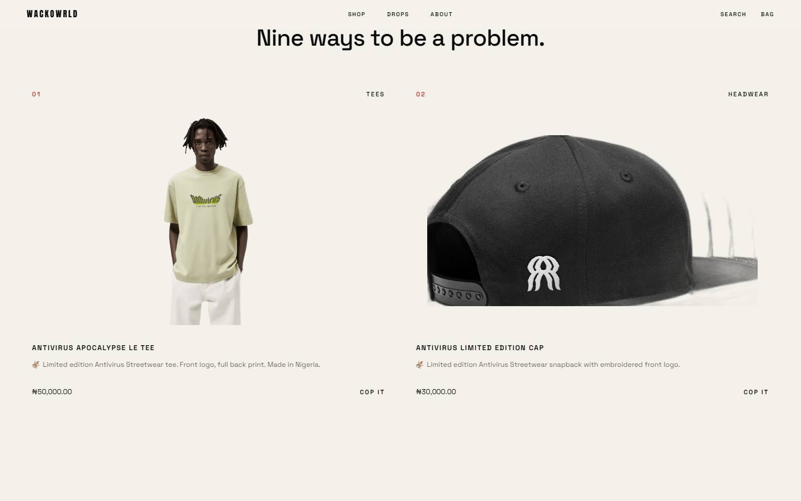

### 2.5 Noir (noir-kappa-two.vercel.app)
| | |
|---|---|
| **Stack** | Vite, Lenis, 8 `<video>` elements, ~140 split characters |
| **Type** | Archivo Variable 900 (H1 at **409px**), JetBrains Mono for data |
| **Colour** | Black `#000`, chalk `#ededeb`, dim `#8b8b88`, red `#ff2a1a` |
| **Layout** | A **0→100 loading counter**, full-screen video chapters ("HEAT IS A TOOL."), a chapter index on the right edge ("03"), a top-centre chapter label ("03 — HEAT"), a **live stat readout** ("Carbon disc temperature 512 °C" with a bar) |
| **Motion** | `grain`, `eq`, `cue`, `ecg` keyframes, scroll-driven chapter changes |
| **Standout** | Every chapter pairs a headline with a number |

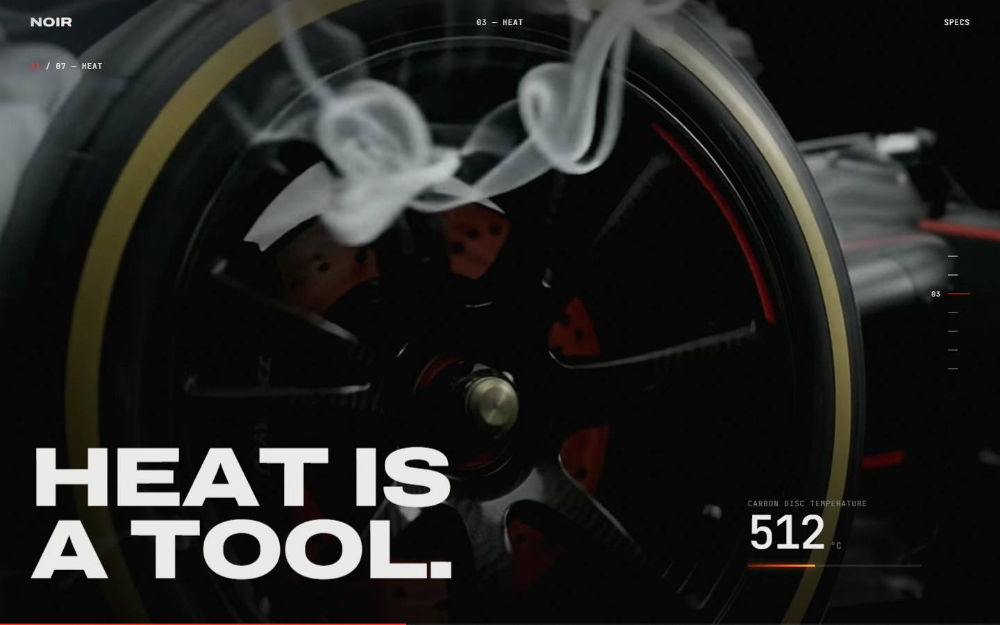

### 2.6 Asake, M$NEY (mr-money-one.vercel.app)
| | |
|---|---|
| **Stack** | Vite, Lenis, 3 WebGL canvases |
| **Type** | Inter Tight 800 for display, JetBrains Mono for labels, Cinzel and Mrs Saint Delafield as rare accents |
| **Colour** | Royal blue `#1e45d8` on a visible grid, paper `#f1f0ec`, lime `#d4ff3d` |
| **Layout** | A WebGL marble bust in the centre, **scattered tilted polaroids**, a watermark name behind, mono corner captions ("TOUCH THE STONE — SCROLL TO BREAK IT ↓"), `(02) — THE SOUND` chapter labels |
| **Motion** | `panelIn`, `eraIn`, words that **split apart as you scroll** ("LAGOS ←→ WORLDWIDE") |
| **Standout** | Physical metaphors (stone, breaking) tied to scroll |

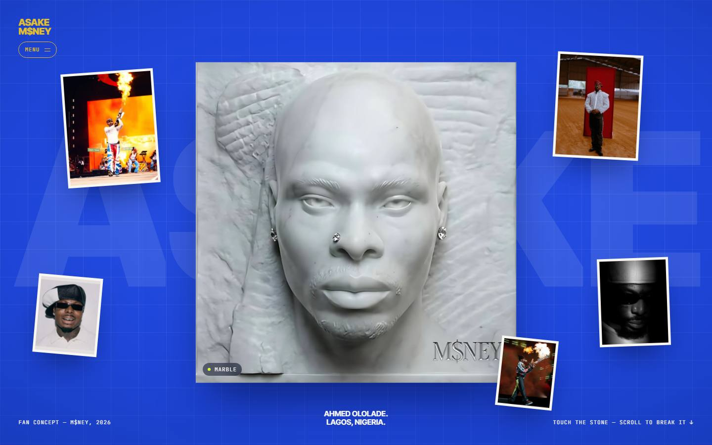
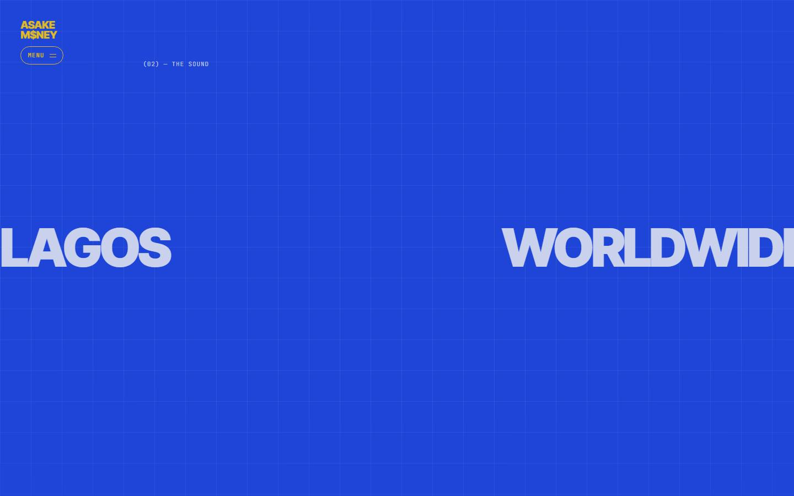

### 2.7 Shanghai, City Archive (shanghai-city.vercel.app)
| | |
|---|---|
| **Stack** | Vite, Lenis, 5 videos, custom cursor |
| **Type** | Inter Tight **300** (H1 at 312px, −0.058em), Instrument Serif italic for one word per heading, IBM Plex Mono for captions, Noto Serif SC for Chinese |
| **Colour** | Ink `#070707`, paper `#ebe6dd`. Opacity steps of paper (`80`, `29`, `1a`) for dim, line and faint |
| **Layout** | Top bar with `SHANGHAI / 001`, a centre chapter label `04 —— TIME` and a menu. **Plate captions** under media ("PLATE 001 — THE BUND, LOOKING EAST"), an aspect-ratio readout |
| **Motion** | **Scroll controls time of day**: the skyline video scrubs from day to night while a large clock (18:42) and a side scale (DAY / GOLDEN HOUR / BLUE HOUR / NIGHT) follow. A top progress bar, `chapter-in`, `grain`, `blink` |
| **Standout** | The best single interaction in the portfolio, and a natural fit for a commuting product |

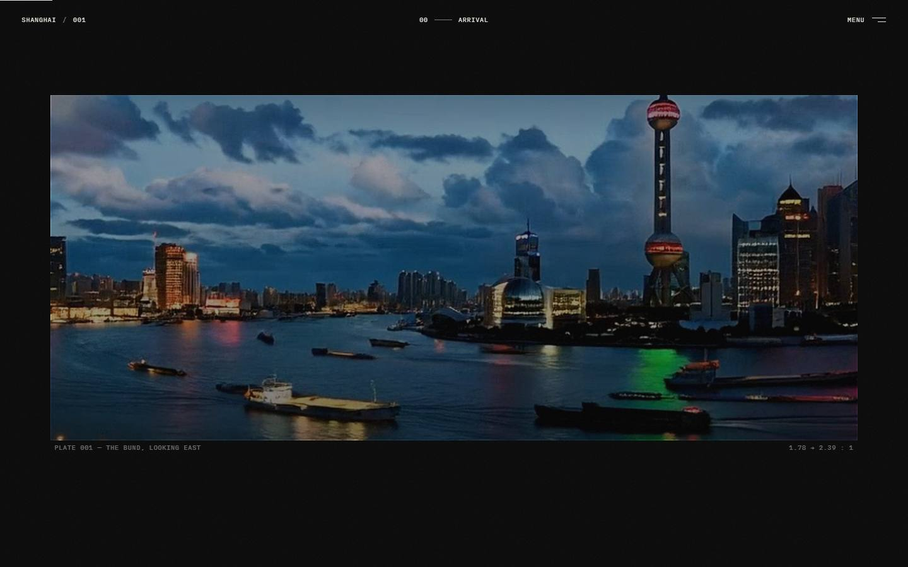
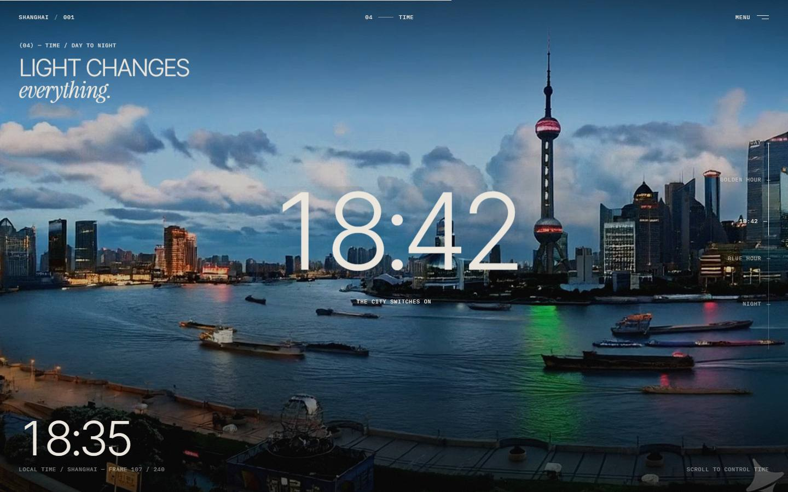

### 2.8 ami, The Art of Scent (ami-one-rho.vercel.app)
| | |
|---|---|
| **Stack** | Next.js, Lenis, a WebGL/canvas frame sequence |
| **Type** | Cormorant Garamond 300 for display, Jost for wide-tracked uppercase UI |
| **Colour** | Warm earth: `#17150f`, `#f4efe5`, olive |
| **Layout** | Storefront hero with "ENTER THE HOUSE ↓". Scrolling **walks you through the door** into the shop, then into a cream product section ("Four ways to be remembered.") |
| **Motion** | Canvas scroll-scrub, `drop`, `sweep` |
| **Standout** | Scrolling feels like walking into a real place |

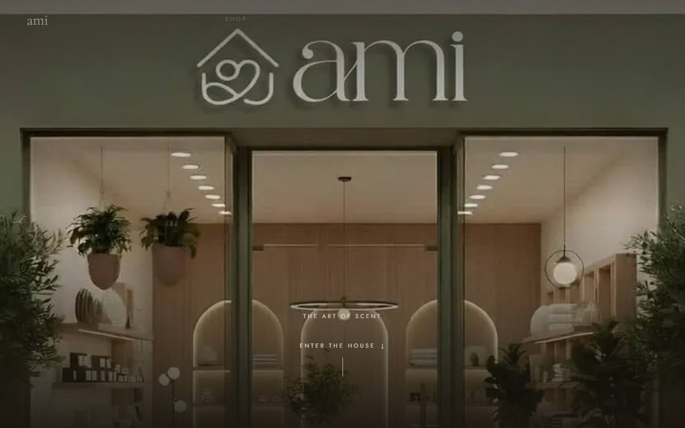
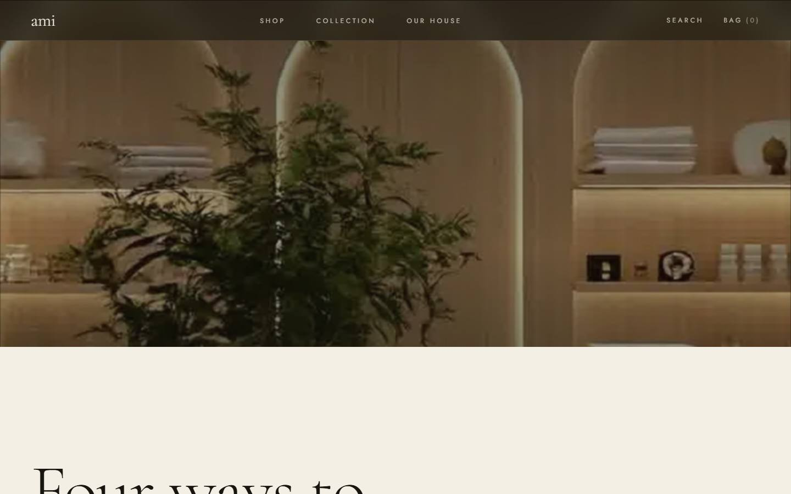

---

## 3. Cross-site patterns (the house style)

| Pattern | Where it appears | Rule worth copying |
|---|---|---|
| **Smooth scroll (Lenis)** | 7 of 8 sites | Always on, gentle duration (~1.1s), switched off for reduced motion |
| **Expo ease** | `cubic-bezier(.16,1,.3,1)` / `(.19,1,.22,1)` / `(.22,.75,.2,1)` | One easing curve for the whole site |
| **One family, plus mono for data** | Inter Tight on 5 of 8 sites. JetBrains or IBM Plex Mono for captions | Mono only where content is data: times, prices, plate captions |
| **Huge, tight, often light display type** | 216px/250, 312px/300, 409px/900 | Big type with negative tracking is the hero, not decoration |
| **One accent colour** | Pink, red, flare, lime: one per site | Use the accent for primary actions and one signal element only |
| **Muted second half of a headline** | SheDrives, Cravvingss | "Your ride in *three steps*": hierarchy without a second font |
| **Numbered chapters and plate captions** | Noir, Shanghai, M$NEY, Wackowrld | `(02) — THE SOUND`, `PLATE 001 — …`, `01 / TEES` |
| **Real photography and video** | Every site | People, places and products, credited |
| **Sticky set-pieces** | SheDrives phone, Shanghai clock, ami door | One scroll-scrubbed moment per page |
| **Dark chapters inside light pages** | Cravvingss orange, SheDrives footer, Wackowrld video | Change the tone to mark a section, not as decoration |
| **Grain, progress bar, scroll cue** | Noir, Shanghai | Small cinematic details, used sparingly |
| **Not used** | No GSAP, no particle backgrounds, no pastel card stacks, no glassmorphism | |

---

## 4. Hop before the redesign

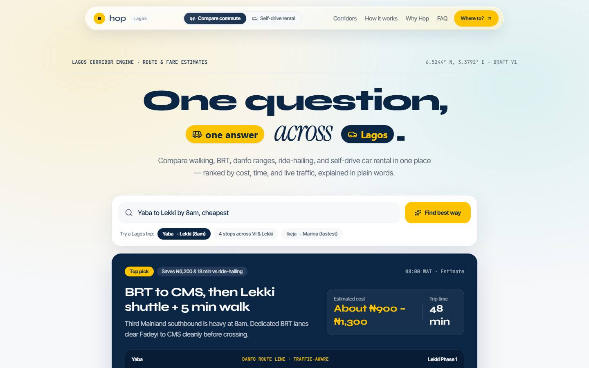
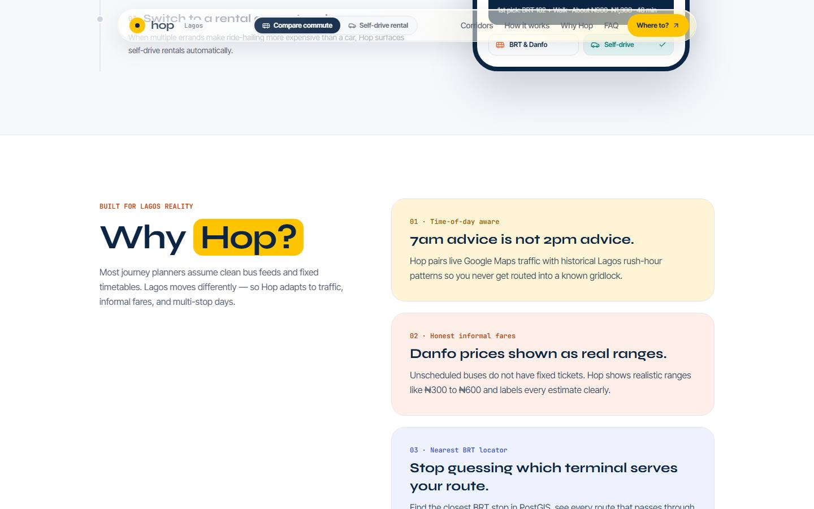

| Issue | What we saw | Why it reads as AI-generated or amateur |
|---|---|---|
| Four fonts | Syne 800 (extra wide), Instrument Serif italic, Plus Jakarta / Inter Tight, JetBrains Mono | The Syne + serif-accent + mono combination is a very common template. Syne also looks cartoonish at this size |
| Multicolour palette | Navy, yellow, plus pastel cream, peach, blue and mint cards, each with its own text colour | No single accent, so nothing stands out |
| Fake telemetry | "LAGOS CORRIDOR ENGINE · ROUTE & FARE ESTIMATES", "6.5244° N, 3.3792° E · DRAFT V1" | Mono labels that carry no information |
| Too many small effects | Text scramble, blinking colon, ping, marquee, refracting "liquid glass" navbar, tilted build-in cards | Many effects, none of them memorable |
| Navbar overlap | The translucent pill nav let headings show through it while scrolling (see the second screenshot) | A visible bug |
| No photography | UI mockups only | Every reference site uses real images |
| Hardcoded colours | `#0B2545` written about 80 times, `#FFC400` about 50 | No design tokens |
| Copy tics | An em dash in nearly every paragraph, "X lies. Y doesn't." headlines | Common AI copy patterns |

---

## 5. The redesign

### 5.1 Direction
A clean product page (SheDrives, Cravvingss) **interleaved with dark cinematic chapters** (Shanghai, Noir). The light sections sell the product. The dark chapters give Hop a memorable moment.

### 5.2 Tokens (`src/index.css`, Tailwind v4 `@theme`)
| Token | Value | Use |
|---|---|---|
| `ink` | `#0E0F0C` | Text, primary buttons |
| `paper` | `#F3F1EC` | Page background (warm, Shanghai/Wackowrld-like) |
| `surface` | `#FFFFFF` | Cards |
| `muted` | `#6B6B65` | Secondary text, greyed headline halves |
| `line` | `ink / 12%` | Hairlines |
| **`signal`** | **`#FF5A1F`** | **The single accent**: primary CTA, route lines, "top pick" dot, progress bar. It suggests traffic lights and rush hour |
| `go` | `#1F9D6B` | Savings figures only |
| `night` / `chalk` | `#0B0B0A` / `#EDEBE6` | Dark chapters |

- **Type (revised):** Newsreader, a serif with optical sizes, for headlines, with real italics marking the second half of a headline, photo captions and chapter labels ("No. 3  Corridors"). Inter Tight sets the interface and every figure, using tabular numerals. The JetBrains Mono uppercase labels were removed: sentence case throughout, closed en dashes in ranges (₦900–1,300), balanced headline wrapping, hanging punctuation.
- **Motion:** one ease (`cubic-bezier(.16,1,.3,1)`), Lenis, and `prefers-reduced-motion` respected (Lenis off, reveals off, grain off).

### 5.3 Page structure
| # | Section | Tone | Pattern borrowed |
|---|---|---|---|
| 1 | Navbar: solid, slim, switches to dark over dark chapters, 2px scroll progress bar | both | Shanghai progress bar, SheDrives simplicity |
| 2 | Hero: stat row, a large headline with a muted second half, the planner, a photo plate with caption, and the result card | light | mustakheem stats, SheDrives headline, Shanghai plate caption |
| 3 | **(01) Rush hour: scroll changes the time** from 06:00 to 22:00 over Third Mainland. Photos crossfade day → dusk → night, a day scale runs down the side, a traffic bar shows congestion, and the best route, fare and ride-hail comparison update every hour | dark | **Shanghai time scrub**, Noir stat readout, grain |
| 4 | (02) How it works: steps light up on scroll next to a sticky phone with three screens | light | SheDrives sticky phone |
| 5 | (03) Corridors: a real vector map of Lagos (MapLibre with OpenFreeMap / OpenStreetMap tiles in a custom dark style), the Ikeja to Lekki corridor drawn along real roads (OSRM), hub pins at true coordinates that fly in to street level, a floating readout, one-tap reports and a live feed | dark | Noir readout, real cartography |
| 6 | (04) Why Hop: numbered rows with hairlines next to a sticky photo | light | mustakheem rows, Wackowrld numbering |
| 7 | (05) Self-drive: scroll-fill paragraph, a dark calculator, photo car cards and list rows, booking dialog | light | Cravvingss scroll fill |
| 8 | (06) FAQ with hairline accordion, then a dark footer with a large CTA, photo credits and an oversized wordmark | light → dark | SheDrives / Wackowrld footer |

### 5.4 Removed
Syne, Instrument Serif and Plus Jakarta; the pastel cards; text scramble; blinking colon; ping; marquee; the liquid-glass refraction navbar (about 400 lines); tilted build-in pieces; the fake coordinate and "DRAFT V1" labels; em-dash-heavy copy; unused Vite assets.

### 5.5 After

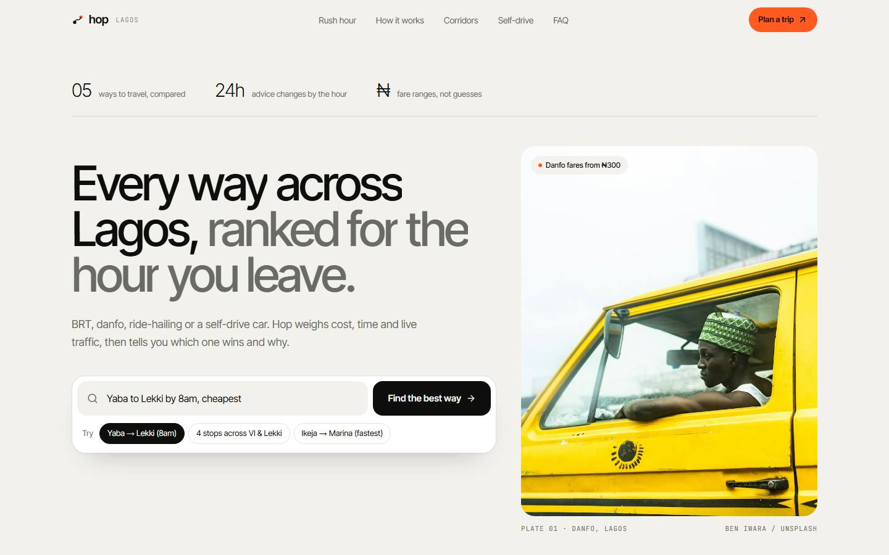
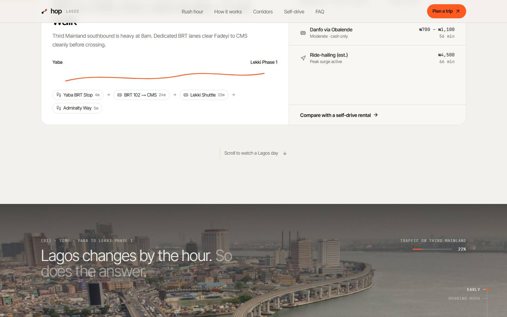
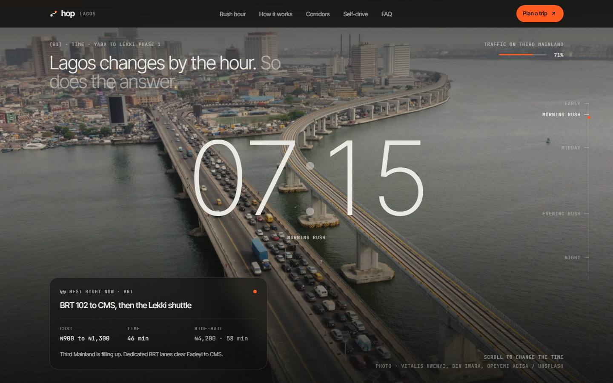
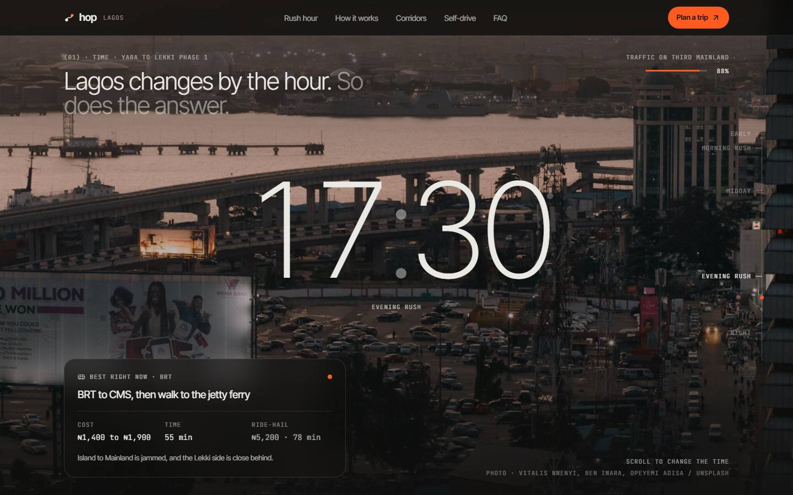
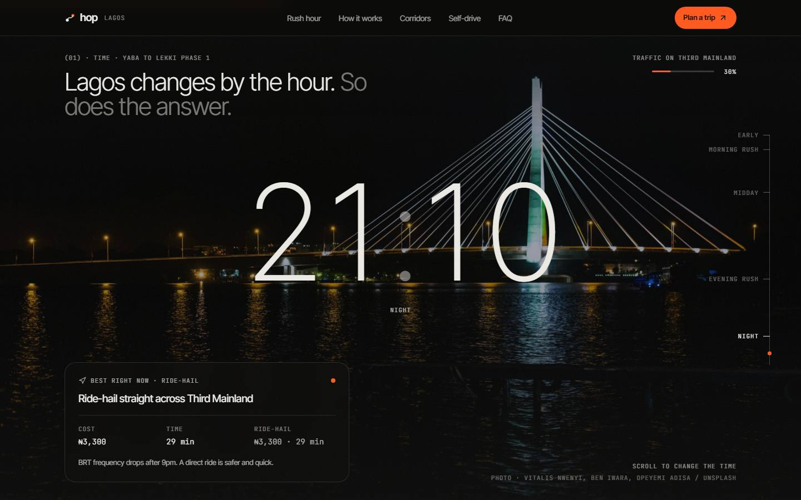
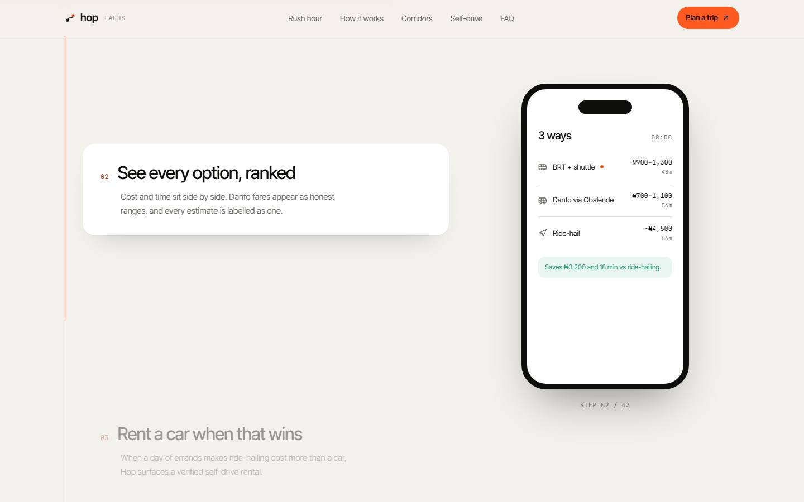
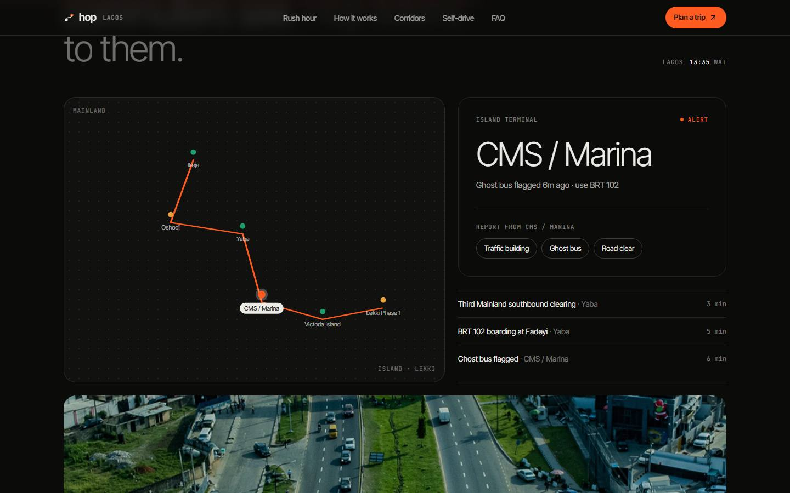
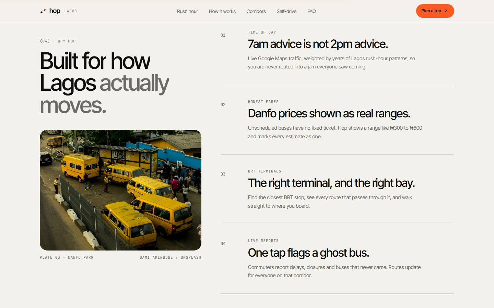
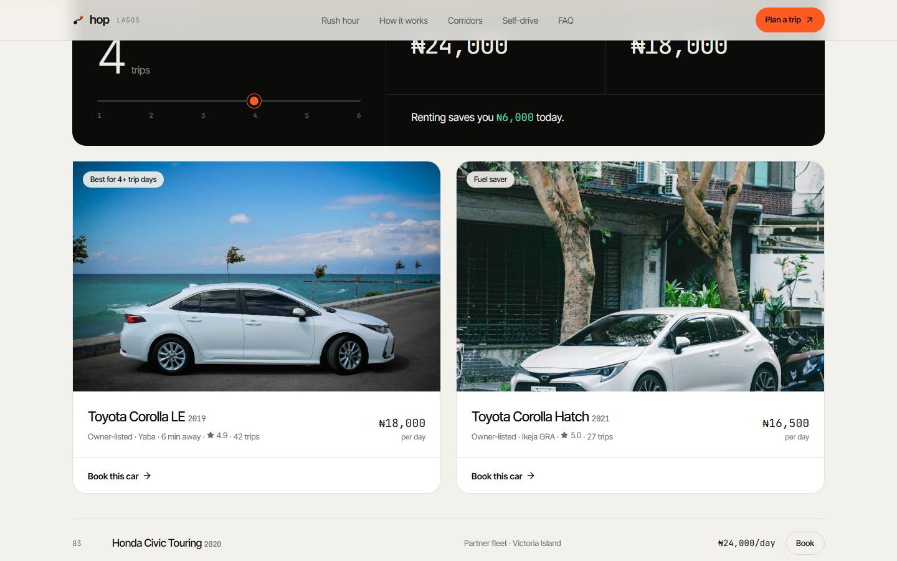
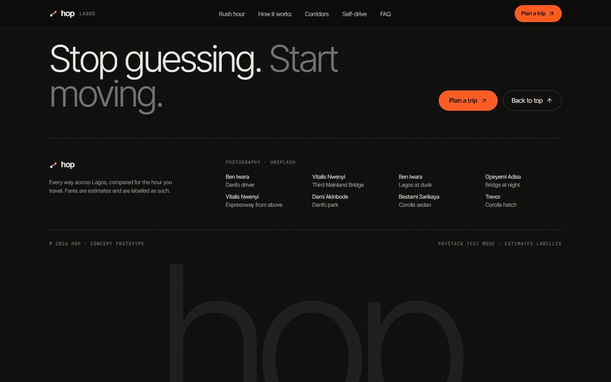

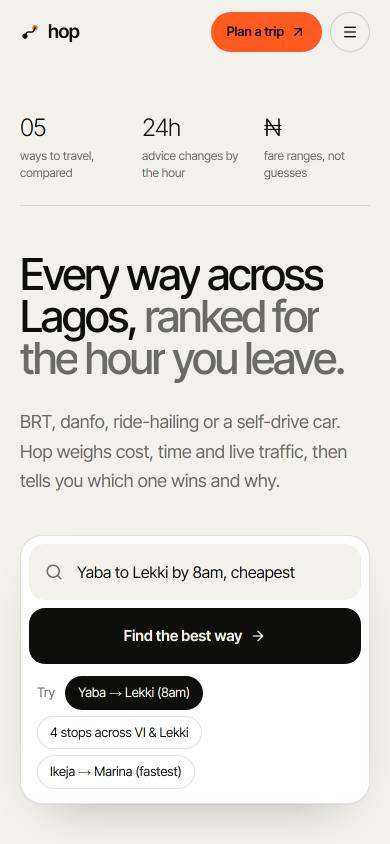

### 5.6 Verification
- `npm run build` and `npm run lint` pass with no warnings.
- Playwright on the dev server reported no console errors. The clock read 07:15 → 11:35 → 17:30 → 21:10, then 11:35 again when scrolled back, so the scrub works both ways.
- The nav background is opaque over content (no overlap).
- With `reducedMotion: 'reduce'`, headline words render in place with no transform.
- No horizontal overflow at 390px.

---

## 6. Credits

Map data © OpenStreetMap contributors, tiles by OpenFreeMap (OpenMapTiles schema), corridor route from the OSRM router.

### Photos (Unsplash License)
| File | Photographer | Source |
|---|---|---|
| `danfo-driver.jpg` | Ben Iwara | unsplash.com/photos/FHo82ziqAaQ |
| `third-mainland-day.jpg` | Vitalis Nwenyi | unsplash.com/photos/xjqrUuUNs7o |
| `lagos-dusk.jpg` | Ben Iwara | unsplash.com/photos/Lpk_o-XeRWo |
| `lagos-bridge-night.jpg` | Opeyemi Adisa | unsplash.com/photos/Ww2j734hEcA |
| `danfo-park.jpg` | Dami Akinbode | unsplash.com/photos/pwMCmK_6-OI |
| `corolla-sedan.jpg` | Bestami Sarikaya | unsplash.com/photos/73XAgT8DOpo |
| `corolla-hatch.jpg` | Trevor | unsplash.com/photos/6pmT6MRvUPM |

---

## 7. Possible next steps
- Replace the photo crossfade in the rush-hour chapter with a real day-to-night time-lapse video of Third Mainland, scrubbed by scroll as Shanghai does.
- Convert the photos to AVIF/WebP with `srcset`. The largest is 1.3 MB.
- Add a short loading counter like Noir's only if the page grows heavy enough to need one. It is not needed now.
- Replace the stock car photos with photos of cars actually listed on Hop.
